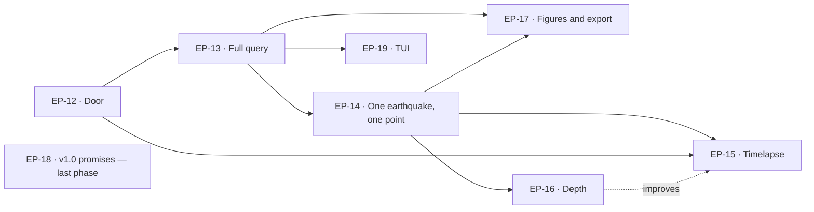

# v1.1 features — scope map

> Artifact 01 of the v1.1 kit · 2026-11-16 · Base commit: `bb58be8` (**v1.0.0** + Flet GUI, ADR-030)
> Input: the repository evaluation of 2026-11-16 and the maintainer's request — *the earthquake
> history cannot be viewed, and there is no timelapse of earthquakes*.
>
> Turns **ten new backlog items (B-44 to B-53)** into **eight epics (EP-12 to EP-19)**. Each of the
> ten appears exactly once.

## 1. What v1.1 is

**v1.0.0 built the history and left no door into it.** The store (`history.py`), the table
(`notify/history_view.py`), the map (`notify/history_map.py`) and the shared filter
(`notify/history_window.py`) exist, are tested, and meet REQ-HIS-001..006 and REQ-MAP-001..005 at
module level. What does not exist is a way to reach that screen that does not go through the tray
menu — and the README itself states that on GNOME/Wayland that menu may not open.

The result, measured on `bb58be8`:

| Fact | Evidence |
|---|---|
| The tray is the only way into the history | `tray.py:156` → `app.py:111` → `wiring.py:391`. `cli.py` has no `--history`; `packaging/vigia-eew.desktop` declares `Actions=Settings;Simulate;` |
| REQ-HIS-005 is met in the store and **not** in the interface | `HistoryQuery` accepts `since`, `until`, `max_distance_km` and `sources`; `HistoryView._build_filters` builds only minimum magnitude and verdict |
| Some rows match the filter and cannot be seen | `HistoryQuery.offset` exists and no control uses it; the list loads 500 and the table draws 150 (`TABLE_ROW_LIMIT`) |
| An earthquake seen by two networks is two symbols on the map | One row per **arrival** (DATA-MODEL §3bis.1); `history_map.plan()` places all of them |
| The history holds only what the agent saw while running, for 90 days | `DEFAULT_RETENTION_DAYS = 90`; there is no recovery (B-32 is still conditional) |
| There is no time-based playback of any kind | No module in `src/` mentions one |
| Two features the roadmap assigned to v1.0 have no code | F-03 (countdown) and F-13 (scheduled drill): no trace in `src/` |

Three different kinds of work, which should not be mixed when discussing scope:

| Kind | Epics | Why the distinction matters |
|---|---|---|
| **A v1.0 promise unmet in practice** | EP-12, EP-13 | The history is unreachable on the maintainer's own desktop, and a `[MUST]` is met only below the interface. This is debt, not new capability |
| **New capability, requested** | EP-14, EP-15, EP-16, EP-17, EP-19 | The timelapse and what it needs in order to make sense. **If something has to be cut, it is cut here** |
| **Documented capability never built** | EP-18 | F-03 and F-13 have been on the roadmap since August. They have no technical relation to the history; they are in because v1.0 promised them (decision D-7) |

**Out of scope, stated so that it does not creep in:** the expected-intensity filter (F-04),
SeedLink (F-05), tsunami warnings (F-08), multiple reference points (F-11), the central relay (B-33)
and presentation under Wayland (B-20, outside the cut since D-1). None was among the ten points.

## 2. The eight epics

| Epic | Name | Items | Story | Kind | Prio | Effort |
|---|---|---|---|---|---|---|
| **EP-12** | The history gets a door | B-44, B-45 | HU-113 | Debt | **P0** | S + M |
| **EP-13** | The interface queries everything the store knows | B-46, B-50 | HU-114 | Debt + improvement | **P1** | M + M |
| **EP-14** | One earthquake, one point | B-47 | HU-115 | New | P1 | S–M |
| **EP-15** | The history in motion | B-48 | HU-116 | **New, requested** | P1 | M–L |
| **EP-16** | A history with depth | B-49 | HU-117 | New | P2 | M |
| **EP-17** | Figures and data out | B-51 | HU-118 | New | P2 | M |
| **EP-18** | What v1.0 promised | B-52 | HU-119, HU-120 | Documented, no code | P2 | S + S |
| **EP-19** | The history over SSH | B-53 | HU-121 | New | P3 | M |

**Effort:** S ≤ 1 h · M ≤ half a day · L > 1 day — the backlog's own scale. These are
order-of-magnitude estimates, not measurements; artifact 09 gives the figure with its range once the
tasks exist.

**Identifiers keep their existing prefixes** (`HU-`, `EP-`, `B-`, `T-`, `REQ-`, `CA-`) even though
this kit is written in English: they continue series the repository already uses, and renaming them
would break every cross-reference into `docs/v1/`.

### Mapping to the ten points of the evaluation

| Point | Item | Epic |
|---|---|---|
| 1 · `--history` and a launcher action | **B-44** | EP-12 |
| 2 · Navigation inside the window | **B-45** | EP-12 |
| 3 · Dates, networks, distance and paging in the interface | **B-46** | EP-13 |
| 4 · A view grouped by earthquake | **B-47** | EP-14 |
| 5 · Timelapse | **B-48** | EP-15 |
| 6 · Recovery from the catalogue (`--backfill`) | **B-49** *(absorbs B-32)* | EP-16 |
| 7 · Tooltip and table ↔ map cross-selection | **B-50** | EP-13 |
| 8 · Statistics and export | **B-51** | EP-17 |
| 9 · Countdown and scheduled drill | **B-52** | EP-18 |
| 10 · History in the TUI | **B-53** | EP-19 |

---

### EP-12 · The history gets a door

**Items:** B-44, B-45 · **Requirements:** REQ-GUI-011..013

The history screen can be opened **without the tray**, and every screen leads to the others.

v1.0 already solved exactly this problem for the configuration panel: REQ-GUI-009 came from finding
that the tray does not open on GNOME/Wayland, and T-150 added `--settings` and the launcher entry.
**The history was built two phases earlier and never got the same treatment.** B-44 copies that
solution: `Application.open_settings()` is eight lines long and `open_history()` would be its twin.

B-45 goes one step further and removes the dependency at the root. `FletShell` shows one screen at
a time and offers no way from one to another: someone who opens the panel with `--settings` cannot
reach the history without closing and launching again. A navigation bar inside the window solves it
for all three screens at once.

**The constraint that is not negotiable (Art. 1):** `FletShell`'s precedence — alert > screen >
nothing — does not change. Navigation is part of *the screen*; while there is an alert, it does not
exist.

**One concrete risk:** switching screens with unsaved edits in the panel. Today that cannot happen
because there is no way to switch; with B-45 it can. REQ-GUI-012 covers it.

**Non-scope:** redesigning the panel or the About screen; adding new screens (those of EP-15 and
EP-17 are views *inside* the history, not navigation destinations of their own).

**Closed when** `vigia-eew --history` opens the history on a GNOME/Wayland session with no tray, and
the panel can be reached from there and back without touching a terminal.

---

### EP-13 · The interface queries everything the store knows

**Items:** B-46, B-50 · **Requirements:** REQ-HIS-007, REQ-HIS-008, REQ-MAP-006, REQ-MAP-007

REQ-HIS-005 says *filter by date range, magnitude, distance, verdict and source network*. The store
does it and there are tests that prove it. **The interface offers two of the five.** The requirement
was verified against `HistoryStore.query`, not against what the user can do — which is the reading
the requirement itself asks for (*"WHEN the user queries"*).

B-46 brings the three missing filters and paging to the interface. It is control work: it touches
neither the schema nor a single statement, because `_SELECT` already covers all of them.

B-50 makes the map answer questions. Today a circle does not say which earthquake it is, and
choosing a row points at nothing on the map. For a view whose whole argument is *"where"*, not being
able to ask *"which one is that?"* delivers half of it.

**How a symbol answers (P-1, checked 2026-11-16).** The map draws its symbols as `CircleMarker`s,
and a `CircleMarker` has neither events nor a tooltip. A `Marker` holding an ordinary control has
both, and a trial with the real client confirmed it: the tooltip shows, pointing and pressing fire,
and the press does not also reach the map. So B-50 moves the history's symbols from `CircleLayer` to
`MarkerLayer`. `plan()` does not change — it already decides position, size and style without a
control — and the size stays in pixels, as now.

**Where the new state lives.** The three filters and the paging are state of `HistoryList`, not of
`HistoryView`: the list is what the terminal frontend reuses (EP-19), and a filter kept in a Flet
control would have to be written twice. The verdict filter offers **the verdicts present in the
history**, as the network filter does with networks, so that EP-16 adds a third verdict without
touching the control.

**The rule that is kept:** `HistoryList` still imports neither the map nor the network
([[lat.md/history#The map is a view on the list, never the other way round]]). Cross-selection is
wired in `HistoryWindow`, which is where whatever joins the two views already lives.

**Non-scope:** free-text search by place (the names come from four catalogues with four conventions;
the reason that column is not sortable is also the reason not to search it).

**Closed when** an earthquake from three weeks ago, from one given network, can be found without
editing a file, and choosing it in the table shows which one it is on the map.

---

### EP-14 · One earthquake, one point

**Items:** B-47 · **Requirements:** REQ-HIS-009

The history keeps **one row per arrival**, and that decision is right: *"it arrived by two networks
and this one prevailed"* is exactly what is worth keeping. But it is the wrong reading for a map
and, above all, for playback over time — an earthquake drawn twice in the same place looks like a
bigger earthquake, or like two.

B-47 adds a **second reading of the same rows**, grouped by correlation id, in which each earthquake
appears once with the data of the arrival that prevailed. Nothing is deleted or merged: the arrivals
are still there and can be reached from the earthquake.

**It is a prerequisite of EP-15.** Without it the timelapse is born showing duplicates.

**Which arrival stands for the earthquake** is the only decision with content: the alerted one if
there is one; if every arrival was discarded, the one from the best-ranked network (the same order
as REQ-ING-011). It is fixed in an ADR in artifact 04.

**Non-scope:** changing what is recorded, or the meaning of `superseded_by`.

**Closed when** an earthquake reported by EMSC and USGS is one symbol on the map and one line in the
table, and both of its arrivals can be consulted from it.

---

### EP-15 · The history in motion

**Items:** B-48 · **Requirements:** REQ-TLP-001..008 *(new area)*

**The request this kit starts from.** Play the history in chronological order on the map:
earthquakes appear when they happened and fade, with controls to pause, seek and change speed.

**The playback advances by earthquake, not by clock (decision D-8).** Each step is the next
earthquake of the filtered set: the window is redrawn when an earthquake happens in the played
period, and not in between. How strongly each earlier symbol is drawn is worked out at that step
from its age. Speed is how long a step stays on screen — in proportion to the real gap to the next
earthquake, between a declared minimum and maximum, so that a swarm does not flash past and a quiet
fortnight does not stall.

A static map of ninety days answers *"where"*. Playback answers *"in what order"* and *"at what
pace"*, which is what tells a swarm from an aftershock sequence and a quiet week from an active
one — and which no table conveys.

It is built with the separation the map already uses: a pure function decides **what is visible at
each instant** — which symbols and how strongly — and a control only paints it. That is what makes
statements such as *"an earthquake never appears before it happens"* checkable without a screen.

#### The four constraints that shape it

| Constraint | Where it comes from | What it implies |
|---|---|---|
| A real alert interrupts playback | Art. 1 | The timelapse pauses itself and the alert takes the window; once acknowledged, it is where it was |
| The timelapse obeys **the same filter** | REQ-MAP-004 | It is a third reading of the table's query, not a query of its own |
| Playing does not fetch extra tiles | E-06 | Playback neither pans nor zooms the map by itself; only the user does |
| No tiles means it says so | REQ-MAP-002 | It inherits the map's notice: dots with no geography beneath are not a timelapse |

#### The risk to measure before committing to the design

**Nobody knows what one redraw of `flet-map` costs.** Each step replaces a layer's list of symbols,
and that crosses from the Python process to the Flutter client. D-8 removed the worst of it — there
is no fixed rate to sustain, and thirty days are as many redraws as they hold earthquakes — but two
things are still unmeasured: how long one redraw takes with N symbols on screen, and what that
becomes now that the symbols are markers carrying a control (EP-13) and not painted circles. The
table already had this problem — 500 rows took seconds, and `TABLE_ROW_LIMIT` came out of it.

So the epic's first task is **a spike with a written verdict**, as T-131 was for Wayland: the cost
of one redraw against the number of symbols, with markers and with circles. Two figures come out of
it: REQ-TLP-007's bound on simultaneous symbols, and the shortest a step can last. The playback
needs no tooltip to play, so if markers turn out too heavy it draws circles while playing and
markers when paused. **If the spike says it is not viable on `flet-map`, the epic is rethought before the
control is written**, not after.

**Non-scope:** exporting the playback to video or GIF; animating wave propagation; sound.

**Closed when** thirty days of history play from start to end in under a minute, with the date
always visible, and a simulated alert during playback interrupts it.

---

### EP-16 · A history with depth

**Items:** B-49 (absorbs **B-32**) · **Requirements:** REQ-HIS-010..013

The timelapse of a freshly installed history is empty, and that of an agent that was off for two
weeks has a two-week hole. **The history only knows what the agent saw.** For an alerting tool that
is correct; for a view of the region's seismicity it is the limitation that weighs most.

B-49 lets the history be completed **on demand** from the catalogues of the networks already
configured. It is the *"escape hatch"* ADR-017 left in place, which the backlog carried as B-32
conditional on *"a real use case"* — the timelapse is that case.

#### What makes this epic delicate

**Recovered earthquakes were never evaluated.** They did not go through the filter when they
happened; nobody was alerted or not alerted about them. Putting them in the table with a verdict
would falsify the very thing the history exists to answer: *"why was I not warned?"*. The honest
answer for a recovered row is *"the agent was not watching"*, and it has to be distinguishable from
a discard.

Two hard rules follow:

1. **A recovered row carries its provenance and is told apart on sight** (REQ-HIS-011).
2. **Recovery does not go through the alert pipeline.** An earthquake from a month ago cannot open
   a window. RF-40 and RF-41 stay intact: recovery is a separate path that writes to the history
   and nowhere else.

**It needs no schema migration.** This artifact first said it did; designing it showed that
*recovered* is a third value of the verdict the table already has, and that the index the
per-earthquake reading uses already exists (ADR-037, artifact 05). `SCHEMA_VERSION` stays at 1.

**What it asks the catalogues for** is set by two keys of its own, `[history] recovery_radius_km`
and `recovery_min_magnitude`: *"my region"* is a different question from *"what should wake me"*.

#### What can be recovered (P-3, checked 2026-11-16)

**EMSC, USGS and GEOFON.** The open question was EMSC, which the agent reads over a WebSocket. It
also serves a standard FDSN catalogue with a date range, at
`https://www.seismicportal.eu/fdsnws/event/1/query`, verified against the live service. Its records
carry the same `unid` the WebSocket delivers, so an earthquake the agent already holds collides on
the existing unique key instead of being duplicated — REQ-HIS-012 for free. All three are the same
kind of service, and `ingest/fdsn.py` already speaks it.

The endpoint is declared in the configuration with a key of its own before it is used
([02 §12](02-PRD-DELTA.md), reading 1).

#### The limitation that has to be said

**FUNVISIS cannot be recovered.** Its only endpoint returns the ~20 most recent events and takes no
date range. The small local earthquakes (M2–3) that only the Venezuelan network catalogues — the
reason RF-38 exists — **will not be in what is recovered**. A completed history holds the seismicity
the global networks see, and it will say so.

#### Decision D-5 — resolved 2026-11-16

Retention removes everything older than 90 days at startup, which would undo a recovery on the next
restart. **Decided by the maintainer: recovered entries get their own retention, 365 days by
default, configurable separately.** Entries the agent evaluated keep their 90. Someone who never
recovers anything sees no change. That same figure is the furthest back a recovery can ask for
(REQ-HIS-012) — recovering what the next startup would delete is not a feature.

**Non-scope:** automatic background recovery; networks that are not already configured.

**Closed when** an empty history is completed with the region's last 90 days, none of those rows can
be mistaken for a discard, repeating the operation duplicates nothing, and the rows survive a
restart.

---

### EP-17 · Figures and data out

**Items:** B-51 · **Requirements:** REQ-EST-001..003 *(new area)*, REQ-HIS-014

The second half of F-10 (*"Local history **and statistics**"*), which v1.0 did not address.

**The figures:** earthquakes per day, and their split by magnitude, by network, and by verdict with
its reason. And one that only this product can give: **each network's latency** — how long each one
takes to deliver an earthquake after it happens. It comes from two columns already stored
(`recorded_at − occurred_at`) and answers with data the question REQ-ING-011 today forces the user
to answer by intuition: *which network should go first?*

**The export:** the filtered set, to a CSV or GeoJSON file, by an explicit action of the user. For
whoever wants to open their data in a spreadsheet or in QGIS.

**A reading of REQ-HIS-006 that has to be written down:** *"the history does not leave the machine"*
forbids **the agent transmitting it**; it does not forbid the user saving a file to their own disk.
The export opens no connection and a test checks that. It needs no amendment, but it does need this
sentence.

#### Decision D-6 — resolved 2026-11-16

**Decided by the maintainer: charts are drawn with the controls already there** — bars built from
containers — and no dependency is added. That is enough for bars. If lines or fine axes are ever
wanted, a charting library is a new decision with its own justification, not an extension of this
one.

**Non-scope:** reports, PDF, comparisons between periods, seismological statistics
(Gutenberg–Richter, b-value).

**Closed when** the screen says how many earthquakes were evaluated in the filtered period and what
each network's median latency is, and the same set opens in a spreadsheet.

---

### EP-18 · What v1.0 promised

**Items:** B-52 · **Requirements:** REQ-ALE-011..013, REQ-UX-007..009

Two roadmap features with no code. They share nothing with the history; they share an epic because
they share a status: promised, small and not done.

> **Decision D-7 — resolved 2026-11-16: in v1.1, as the last phase, and cuttable.** One version
> closes what was promised, and if the release has to ship sooner this phase is what moves.

**Countdown to the shaking (F-03).** The alert says how many seconds remain until the S wave, or
says that it should already have arrived. All the information is in `SeismicEvent`.

Honesty is part of the requirement, not a garnish: with catalogue sources the event arrives
**after** the shaking. Measured on the local history, three months of it (P-4, [README](README.md)): of 588
arrivals within 1 000 km, none was received before its S wave, and the alerts came a median of 19.5
minutes late. That is the case to design for, not the frequent one — the only one seen.

**Decision D-9 — resolved 2026-11-16.** The estimate is a constant 3.5 km/s over the hypocentral
distance, so that a deep earthquake under the reference point does not read as zero seconds. When
the shaking should already have arrived, the alert says roughly how long ago. When there is time
left, the count rounds down. No travel-time table and no dependency are added while no source
delivers within seconds. Hiding it would turn the feature into
decoration. And it is an estimate from a simple model — a constant velocity — that has to be
presented as one.

**Scheduled drill (F-13).** `--simulate` exists; what is missing is the agent firing it by itself
every so often. It is testing the smoke detector: an agent that goes months without alerting has no
other way to show it is still alive on that machine.

Two rules, both from Art. 1: a drill **is labelled as a drill** — nobody should believe the ground
is shaking — and it **never displaces or delays a real alert**.

**Where the record of the last drill lives** is fixed in the Data Model delta (05). One thing is
fixed here because other epics lean on it: a drill is never a row of the history's `events` table.
That is what lets the table, the map, the playback, the figures and the export ignore drills
without each of them having to filter them out.

**Non-scope:** the expected-intensity filter (F-04), which changes *what* is alerted and needs field
data; own detection from waveforms (F-05); a travel-time model finer than a constant velocity
(D-9).

**Closed when** the simulated alert shows the estimated time or how long ago the shaking should have
arrived, and a scheduled drill fires, is acknowledged and leaves a record.

---

### EP-19 · The history over SSH

**Items:** B-53 · **Requirements:** REQ-HIS-015 `[SHOULD]`

The TUI (`--tui`) exists for machines with no display, which is exactly where a queryable history
saves the most: today the only way to know why a server did not alert is to read its log.

Only the **list**, with the same filters. No map and no timelapse: they do not fit in a terminal,
and the v1.0 rule already says which of the views is the feature.

`HistoryList` does not depend on Flet — it decides what is shown and draws nothing — so the TUI
reuses it as it is. That is ADR-030's separation paying for a second frontend.

**It is `[SHOULD]` and it is the first thing to be cut.** It follows the precedent of REQ-GUI-006
(panel in the TUI), deferred in v1.0 for the same reason.

**Closed when** `vigia-eew --tui` offers the filterable list over an SSH connection.

---

## 3. Proposed order

Artifact 06 fixes the final order with its dependency graph. This is the sequence the epics impose
by themselves, with D-7 applied:

| Order | Epic | Why there |
|---|---|---|
| 1 | **EP-12** | Without a door, nothing else can even be seen. It is also the cheapest |
| 2 | **EP-13** | The date filters are what the timelapse uses to bound what it plays |
| 3 | **EP-14** | Prerequisite of the timelapse |
| 4 | **EP-15** | The request. Starts with its spike |
| 5 | **EP-16** | Improves the timelapse without blocking it: it works with whatever there is |
| 6 | **EP-17** | Needs the filters and the per-earthquake reading; nothing else |
| 7 | **EP-19** | `[SHOULD]`; independent, and the first to fall |
| 8 | **EP-18** | Last phase by D-7. Independent of everything else |

### Where the epics touch

Eight places where one epic's requirement lands on another epic's code. Each is settled by a rule
the **earlier** epic follows, so the later one extends it without reopening it — and so that cutting
the later one leaves nothing half-built.

| # | Epics | Where they touch | Rule that settles it | Owner |
|---|---|---|---|---|
| X-1 | EP-13 ↔ EP-16 | REQ-HIS-011: the verdict filter isolates what was recovered | To every reader, *recovered* is a **third verdict**. The filter lists the verdicts present in the history; `marker_style()` gets a third style. How it is stored is 05's | EP-13 builds the filter open; EP-16 adds the value |
| X-2 | EP-16 ↔ EP-17 | REQ-EST-002: latency only over what was received live | One predicate, *received live* = verdict alerted or discarded, defined beside `HistoryQuery`. With EP-16 cut, every row satisfies it | EP-17 |
| X-3 | EP-17 ↔ EP-18 | REQ-UX-008: the figures do not count drills | A drill is never a row of `events`. Nothing to filter | EP-18, by construction |
| X-4 | EP-12 ↔ EP-15 | REQ-TLP-006: after an alert the playback is back, paused, where it was | `FletShell` already keeps the screen object while an alert shows and renders it again afterwards. EP-12 keeps that true through navigation (REQ-GUI-013) and gives a screen a notice that it was covered; EP-15 pauses on that notice | EP-12 owns the notice; EP-15 uses it |
| X-5 | EP-15 ↔ EP-16 | REQ-HIS-011: recovered rows are told apart in playback | The playback takes each symbol's style from `marker_style()`, like the static map. It has no styles of its own | EP-15 |
| X-6 | EP-13 ↔ EP-14 | REQ-MAP-007: exactly one symbol highlighted | Selection is keyed by the id of the row a symbol stands for. In the per-earthquake reading that is the prevailing arrival's row | EP-13 keys by row id; EP-14 supplies the row |
| X-7 | EP-13 ↔ EP-19 | REQ-HIS-015: the same filters in the terminal | Filter and paging state live in `HistoryList`, which imports no toolkit | EP-13 |
| X-8 | EP-14 ↔ EP-17 | REQ-EST-001 and REQ-HIS-014 say *"the filter's count"*, and there are two readings | Figures about earthquakes — per day, by magnitude, by verdict and reason — count earthquakes. Figures about networks — split by network, latency — count arrivals. The export writes the reading on screen. Each states its base (REQ-EST-003) | EP-17, which therefore follows EP-14 |

X-8 is the only one that changes the order: EP-17 was drawn as depending on EP-13 alone, and it
depends on EP-14 too. X-4 adds the edge EP-12 → EP-15, which the sequence already respected.

**Minimum cut that delivers the request:** EP-12 + EP-13 + EP-14 + EP-15. Everything else improves
that core or is independent of it.

**Order of cutting, if it comes to that:** EP-19 first (it is the only `[SHOULD]`), then EP-18 (D-7
made it cuttable), then EP-17, then EP-16.

## 4. What this kit does not do

- **It does not amend the constitution.** None of the ten items changes a standing restriction:
  recovery uses the seismic sources already declared (E-06 a), the timelapse uses the map already
  authorised (E-06 c) and the export transmits nothing. That is why **there is no artifact 00** in
  this folder. The three readings behind that are in [02-PRD-DELTA §12](02-PRD-DELTA.md), and the
  Analyze (08) checks them again with the design in front of it.
- **It does not rewrite what v1.0 specified.** REQ-HIS-001..006 and REQ-MAP-001..005 are inherited
  by reference from [`docs/v1/02-PRD-DELTA.md`](../v1/02-PRD-DELTA.md).
- **It does not fix the drift in `docs/v1/HU/HU-112`**, which still describes the map on Tk and
  Pillow although ADR-030 moved it to `flet-map`. It is noted for the Analyze rather than fixed in
  passing.
- **It does not translate the v1.0 kit.** `docs/v1/` stays in Spanish. This kit is in English by the
  maintainer's decision of 2026-11-16, which also matches the repository's own convention (RNF-10);
  requirement texts inherited from v1.0 are cited by identifier, not re-rendered.
