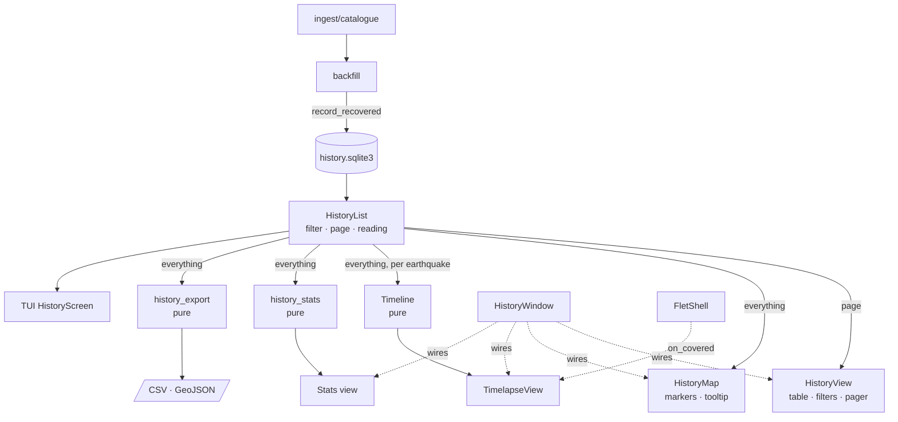

# Technical Design delta — Vigía-eew v1.1

> Artifact 04 of the v1.1 kit · 2026-11-16 · Base commit: `bb58be8`
> Base documents: [`docs/TECHNICAL-DESIGN.md`](../TECHNICAL-DESIGN.md) (ADR-001..ADR-030) and
> [`docs/v1/04-TECHNICAL-DESIGN-DELTA.md`](../v1/04-TECHNICAL-DESIGN-DELTA.md)

## 1. What is inherited, what is extended and what is decided here

| | Count | Which |
|---|---|---|
| **Inherited unchanged** | 27 | ADR-001..030 except the three below |
| **Extended, not amended** | 3 | **ADR-025** (the history gets a third verdict and a second retention) · **ADR-027** and **ADR-030** (the history's symbols become markers) |
| **New here** | **11** | **ADR-031..ADR-041** |

Nothing is amended: no standing decision is reversed. The numbering continues the project's single
series.

### New modules

| Module | Kind | Imports a toolkit | Decided in |
|---|---|---|---|
| `notify/navigation.py` | control | Flet | ADR-031 |
| `notify/timelapse.py` | **pure** | no | ADR-035 |
| `notify/timelapse_view.py` | control | Flet | ADR-035 |
| `ingest/catalogue.py` | adapter | no | ADR-036 |
| `backfill.py` | orchestration | no | ADR-036 |
| `history_stats.py` | **pure** | no | ADR-038 |
| `history_export.py` | **pure** | no | ADR-038 |
| `notify/history_stats_view.py` | control | Flet | ADR-038 |
| `shaking.py` | **pure** | no | ADR-039 |
| `drill.py` | **pure** | no | ADR-040 |

Six of ten draw nothing. That is ADR-030's rule applied again: what decides is separate from what
paints, so that what the requirements promise can be checked with no display.

---

## 2. ADR-031 · Navigation is part of the screen, and a screen is told when it is covered

**Context.** The history is reachable only from the tray. `FletShell` shows one screen and offers no
way to another. Its precedence — alert > screen > nothing — is Art. 1 in code.

**Decision.**

1. `Application.open_history()` is the twin of `open_settings()`: standalone window, no agent, no
   tray. `--history` dispatches to it before the other modes, as `--settings` does. Each packaged
   platform's launcher entry gets a *History* action beside *Settings*.
2. A navigation bar (`notify/navigation.py`) with three destinations — history, settings, About —
   is composed **into each screen's view** by `Wiring`, not into the shell. The shell keeps
   rendering either the alert or the screen; since the bar is inside the screen, it is absent
   whenever the alert is shown, with no rule that could be forgotten.
3. `Wiring` keeps the panel instance alive across navigation, as it already does between the panel
   and About. Switching screens therefore discards nothing: an unsaved edit is in its field on
   return. Closing the window with unsaved edits behaves as it does today.
4. `FletShell.show_screen()` accepts two optional callbacks, `on_covered` and `on_uncovered`. The
   shell calls them when an alert takes the window from that screen and when it gives it back. The
   shell already keeps the screen object across an alert; this only tells the screen.

**Alternatives rejected.** *A navigation rail owned by the shell*: it would have to be hidden under
an alert by a condition, and a condition is what gets broken by accident. *A dialog asking to save
before switching*: it interrupts a move that loses nothing. *Separate windows per screen*: Flet
drives one window per process (ADR-030).

**Consequences.** `--history` from a second process opens a second, standalone window; it cannot
reach the agent's window, so it cannot displace an alert there (REQ-GUI-013). The callbacks are the
contract HU-116 pauses on (X-4).

*Satisfies REQ-GUI-011..013.*

---

## 3. ADR-032 · The list owns the filters and the paging; the map reads the whole set

**Context.** `HistoryQuery` takes six criteria and the screen sets two. `offset` is never set. The
list loads 500 rows, the table draws 150, and the map draws whatever the list loaded.

**Decision.**

1. `HistoryList` — which imports no toolkit — owns the filter and the page. It gains setters for
   the date range, the maximum distance and the networks, and `next_page()`, `previous_page()` and
   `stretch` (first, last, total). Setting any filter returns to the first page.
2. Dates are entered as **local calendar days** in `[notification] timezone` and converted to UTC
   bounds by `timeutil`, the module that already owns the local-day boundary (RF-40). A range that
   ends before it starts is refused by the list and the previous query stays.
3. The verdict filter is built from `HistoryStore.verdicts()`, as the network filter is from
   `sources()`. A verdict added later needs no change in the control (X-1).
4. The page size is the table's limit (`TABLE_ROW_LIMIT`, 150). The list stops loading more than it
   shows.
5. **The map does not page.** It reads the filtered set in full through `HistoryList.everything()`,
   up to `MAP_SYMBOL_LIMIT`, and says so on screen when the set is larger. The playback reads the
   same.

**Alternatives rejected.** *The map draws the table's page*: turning a page would move the symbols,
and REQ-MAP-004's *"same set"* would mean *"same 150 rows"*. *Filter state in the Flet controls*:
the terminal frontend would have to implement it again (X-7).

**Consequences.** Two reads per filter change instead of one: the page and the set. Both are
indexed. `MAP_SYMBOL_LIMIT` is fixed by the same spike that fixes the playback's bound (T-163).

*Satisfies REQ-HIS-005 (strengthened), REQ-HIS-007, REQ-HIS-008.*

---

## 4. ADR-033 · The history's symbols are markers

**Context (P-1, checked 2026-11-16).** A `CircleMarker` in `flet-map` 1.0.4 has no events and no
tooltip. A `Marker` holding a control has both; a trial with the real client showed the tooltip,
`on_hover` and `on_click` firing, and the click not reaching the map.

**Decision.**

1. `HistoryMap.show()` builds a `MarkerLayer` of `Marker`s whose content is a round `Container`.
   `plan()` is unchanged in what it decides — position, size, style — and gains a `selected` row id.
2. The tooltip text is built from the **row the list already formatted** for the table, not
   formatted again. *"The data shown are those of the table entry"* then holds by construction.
3. Selection is keyed by the id of the row a symbol stands for (X-6). The selected symbol gets a
   thicker ring and a larger size — not a colour — following the rule the map already applies
   between alerts and discards.
4. The wiring lives in `HistoryWindow`: a row chosen in the table calls the map; a marker pressed
   calls the list, which moves to the page holding that row. `HistoryList` still imports neither.

**Alternatives rejected.** *Keep circles and select by proximity to the tap* (`Map.on_tap` reports
coordinates): it works for pressing, not for pointing, and it guesses. *Both layers, circles to
draw and invisible markers to hit*: twice the controls for nothing.

**Consequences.** A marker carries a control; a circle is a painted shape. The cost per symbol goes
up and is what T-163 measures. The alert's own map (`map_view.py`) is untouched.

*Satisfies REQ-MAP-006, REQ-MAP-007. Extends ADR-027/030.*

---

## 5. ADR-034 · A second reading: one row per earthquake

**Context.** The history stores one row per arrival, tied by `correlation_id`. Right for storing;
wrong for a map and for playback.

**Decision.**

1. `HistoryQuery` gains `reading`: `"arrival"` (default, as now) or `"earthquake"`.
2. In the earthquake reading the filters apply to **arrivals first**, and the matching arrivals are
   then grouped by `correlation_id`. The row that stands for each group is chosen by, in order:
   verdict *alerted*; `superseded_by` empty; the network's rank (REQ-ING-011); the lowest row id.
3. It is one prepared statement per ordering, using a window function
   (`ROW_NUMBER() OVER (PARTITION BY correlation_id ORDER BY …)`). The network rank is passed as one
   bound, delimited string and read with `instr()`, the technique `sources` already uses — nothing
   is interpolated.
4. `count()` in that reading is `COUNT(DISTINCT correlation_id)`.
5. `HistoryStore.arrivals(correlation_id)` returns every arrival of one earthquake.

**Alternatives rejected.** *A materialised `earthquakes` table*: a second source of truth to keep in
step with every write, for a reading. *Grouping in Python*: paging and counting would then be done
on rows that have not been grouped yet.

**Consequences.** No schema change — `events_correlation_id` exists. The representative is decided
in one place, which the map, the playback, the figures and the export all read. A recovered row
(ADR-037) ranks below an alerted one and beside a discarded one, by the same rule.

*Satisfies REQ-HIS-009.*

---

## 6. ADR-035 · The playback: a pure timeline that steps by earthquake

**Context.** Decision D-8: the playback advances from one earthquake to the next, not by a clock.

**Decision.**

1. `notify/timelapse.py` is pure. `Timeline(records, fade, trail)` sorts the earthquakes by time of
   occurrence; earthquakes at the same instant share a step.
   - `frame(i)` → the instant of step *i* and, for each earthquake at or before it, an intensity.
   - Intensity is a function of **age in the history's time** at that instant: 1 at age zero,
     non-increasing, in a small number of discrete levels, reaching 0 at `fade` — or the lowest
     level instead of 0 when `trail` is on.
   - `dwell(i, speed)` → how long step *i* stays: the real gap to step *i+1* divided by the speed,
     clamped to `[MIN_DWELL, MAX_DWELL]`.
2. A frame depends only on *i*. Seeking is `frame(i)`; so is playing. They cannot disagree.
3. `notify/timelapse_view.py` paints a frame into the map's layer and holds the controls: play,
   pause, a slider over the steps, the speed, the trail switch, the instant in local time and the
   period. It advances by scheduling the next step with `FletShell.after()`, the shell's existing
   timer; pausing invalidates the pending step by a generation counter.
4. Speeds are declared as history time per second of viewing: 6 hours, 1 day, 1 week.
5. The view never calls a method that moves the map (REQ-TLP-008).
6. It reads `HistoryList.everything()` in the earthquake reading — the set of ADR-032 and the
   grouping of ADR-034. If the set exceeds `PLAYBACK_SYMBOL_LIMIT` it plays the most recent ones
   and a notice says how many of how many.
7. It registers `on_covered` with the shell (ADR-031) and pauses there.

**Alternatives rejected.** *A fixed frame rate* (D-8): a redraw rate unrelated to the data.
*Continuous fading between steps*: it is a clock again. *The playback as its own screen*: it would
need its own filter, and REQ-TLP-004 says there is one.

**Consequences.** `MIN_DWELL`, `MAX_DWELL` and `PLAYBACK_SYMBOL_LIMIT` are constants whose values
come from T-163 and cite it. Thirty days play in under a minute only if
`PLAYBACK_SYMBOL_LIMIT × MIN_DWELL ≤ 60 s`; the spike has to deliver figures that satisfy it or say
that the closing criterion of EP-15 cannot be met.

*Satisfies REQ-TLP-001..008.*

---

## 7. ADR-036 · Recovery is a separate path that writes only to the history

**Context.** REQ-HIS-010..012. The ingestors exist to alert: they feed `raw_queue`, and everything
downstream of it can open a window.

**Decision.**

1. `ingest/catalogue.py` reads a **period** from an FDSN catalogue: `fetch(spec, since, until)`
   yields raw payloads in the dialect each network's normaliser already understands — GeoJSON for
   USGS and EMSC, pipe-delimited text for GEOFON. It asks in windows of 30 days and pages with
   `limit`/`offset`, so that no request depends on a server's maximum.
2. `SourceSpec` gains `recovery`: how to read that source's catalogue, or the reason it cannot be
   read. FUNVISIS declares the reason. The outcome of a recovery is built from the registry, so a
   fifth source cannot be silently left out.
3. `backfill.py` orchestrates: for each recoverable source, in priority order — fetch, normalise
   with the pipeline's normalisers, and write through `HistoryStore.record_recovered()`.
4. It **does not** import or call the processor, the filter's verdict, the deduplicator's state,
   the supervisor, the alert controller or `StateStore`. An import contract enforces it.
5. Joining what is there:
   - same network and id already present → left alone (`ON CONFLICT DO NOTHING`);
   - otherwise, rows within the deduplicator's time window are compared with its own predicate
     (RF-09: ≤ 100 km, ≤ 90 s, ≤ 0.5 magnitude), extracted from `Deduplicator._matches` into a
     module-level function both use. A match gives the new row that earthquake's `correlation_id`
     and points `superseded_by` at its prevailing row. No match mints a new `correlation_id`.
6. One source failing is logged and reported; the others continue (Art. 3).
7. A period reaching further back than `recovered_retention_days` is refused before any request.
8. Entry points: `vigia-eew --backfill DAYS`, which prints the outcome and exits, and a *Recover…*
   action on the history screen, which runs it on a worker thread and refreshes the views.

**What is asked of the catalogues.** The circle of `[history] recovery_radius_km` around the
reference point, from `[history] recovery_min_magnitude` up. Defaults: 1 000 km and 2.5.

**Alternatives rejected.** *Feed recovered events into `raw_queue` with a flag*: every stage would
have to honour the flag, and the one that forgot would alert on a month-old earthquake.
*Recovery in the background at startup*: out of scope, and it would make a network outage at
startup a history problem.

**Consequences.** The EMSC catalogue is a new URL on a declared host; it is declared in
`[emsc] catalog_url` (§12 of the PRD delta). `distance_km` of a recovered row is the distance to
the reference point at the time of recovery, which is the only one available.

*Satisfies REQ-HIS-010, REQ-HIS-011 (never alerts), REQ-HIS-012.*

---

## 8. ADR-037 · "Recovered" is a third verdict, and the schema does not change

**Context.** REQ-HIS-011 asks that a recovered entry carry its provenance, never read as alerted or
discarded, and be isolated by the verdict filter. The features artifact expected a schema migration.

**Decision.**

1. A recovered row is stored with `verdict = 'recovered'` and no reason. No column is added.
   `SCHEMA_VERSION` stays at 1.
2. `prune()` applies two cut-offs in one statement: `recovered_retention_days` to rows whose
   verdict is *recovered*, `retention_days` to the rest. The existing step that clears
   `superseded_by` on rows about to lose their target is kept and covers both.
3. `record()` — the live path — already replaces the row of the same arrival. A recovered row is
   therefore overwritten by the agent's verdict if that arrival is later evaluated live.
   `record_recovered()` never overwrites.
4. *Received live* is one predicate — verdict is *alerted* or *discarded* — defined beside
   `HistoryQuery` and used by the latency figure (X-2).
5. `marker_style()` gains a third style; an unknown verdict is still drawn as a discard.

**Why not a `provenance` column.** The verdict column already answers *"what did the agent do with
this arrival?"*, and *"it was not watching"* is an answer to that question, not a second question.
A separate column would allow *alerted + recovered*, a state REQ-HIS-011 forbids, and would need the
first migration of a user's own record to make it representable.

**Alternatives rejected.** *A `provenance` column with a migration to version 2*: above. *A
separate table for recovered rows*: every reading would become a union.

**Consequences.** The features artifact said EP-16 needed the first schema migration; it does not,
and the sentence is corrected. The migration mechanism (REQ-HIS-003) stays untested by a real
second version, as it is today. A v1.0 agent opening this file finds a verdict it does not know and
draws it as a discard — degraded, not broken; noted in the Analyze (V-04).

*Satisfies REQ-HIS-011 (provenance), REQ-HIS-013. Extends ADR-025.*

---

## 9. ADR-038 · Figures and export are pure modules over the filtered set

**Decision.**

1. `history_stats.py` computes a `Summary` from two sequences — the earthquakes and the arrivals of
   the current filter — in Python. Earthquakes feed the splits per day, by magnitude band and by
   verdict and reason; arrivals feed the split by network and the latency (X-8).
2. Latency is the **median** of `recorded_at − occurred_at` over the arrivals received live, per
   network, with its sample size. A network with none has no figure.
3. Every figure carries the number of entries it was computed over and the period (REQ-EST-003) as
   fields of the result, not as text added by the view.
4. `notify/history_stats_view.py` draws bars as `Container`s whose width is proportional to the
   value (D-6).
5. `history_export.py` writes a sequence of records as CSV or as GeoJSON to an open file. Instants
   are ISO-8601 in UTC with offset; GeoJSON points are `[longitude, latitude]`. It imports `csv` and
   `json` and nothing else from outside the package; a test on its imports says so.
6. The view writes to a temporary file beside the destination and renames it, the pattern
   `StateStore` and `ConfigWriter` already use, so that a failure leaves nothing partial.
7. The destination comes from Flet's `FilePicker.save_file()`. Where that is not available, the
   view offers a path field pre-filled with the user's documents directory (P-5).

**Alternatives rejected.** *Aggregates in SQL*: five more prepared statements for sets the
retention already bounds. *A charting library*: D-6.

**Consequences.** The whole filtered set is read into memory for the summary and the export. Today
the local history holds ~14 000 rows; acceptable, and bounded by the retentions.

*Satisfies REQ-EST-001..003, REQ-HIS-014.*

---

## 10. ADR-039 · Time until the shaking: constant velocity over the hypocentral distance

**Context.** Decision D-9, after measuring that no arrival within 1 000 km beat its S wave.

**Decision.**

1. `shaking.py` is pure: `estimate(event, now) → ShakingEstimate | None`.
   - hypocentral distance = √(`distance_km`² + `depth_km`²);
   - travel time = hypocentral distance ÷ `S_WAVE_KM_S` (3.5);
   - arrival = `time_utc` + travel time; the result is the signed difference to `now`.
2. It returns `None` — and the caller logs why — when the origin time is later than `now` by more
   than a tolerance, or an input is not finite. The alert is presented without the line.
3. Presentation (`notify/presentation.py`): remaining → whole seconds, rounded **down**, with the
   approximation mark; elapsed → seconds below a minute, whole minutes above, with the mark.
4. The alert window re-evaluates once a second with `FletShell.after()` while it is on screen; the
   terminal alert does the same with Textual's interval. A revision of the event recomputes it.
5. No travel-time table and no dependency (D-9).

**Assumptions, declared.** One velocity for all depths and distances; a straight path; a
preliminary location. Beyond ~150 km the fastest S path runs through the mantle and the model is a
few seconds late; rounding down is what keeps that on the safe side.

**Consequences.** `SeismicEvent.depth_km` is a required, non-negative number, so the estimate does
not fail for lack of a depth; a network that reports none is normalised upstream. REQ-ALE-013's
criterion is worded with the case that can occur — an origin time ahead of the clock.

*Satisfies REQ-ALE-011..013.*

---

## 11. ADR-040 · The scheduled drill is a simulated alert the queue knows to be one

**Decision.**

1. `[drill] enabled` (default false) and `interval_days` (default 30).
2. `drill.py` is pure: `is_due(last, now, interval) → bool`.
3. A supervised task wakes hourly. If a drill is due, notifications are not paused and the alert
   queue is empty and idle, it enqueues `simulated_event()` — the event `--simulate` uses. Otherwise
   it waits for the next wake.
4. A simulated event is recognised by `source == "SIMULATED"`, which it already carries. The
   presentation labels every such alert as a drill, in both frontends and both languages — so
   `--simulate` gets the label too.
5. `AlertQueue`: when a real event is enqueued while the alert on screen is a drill, the drill is
   closed without acknowledgement and the real alert is shown.
6. `state.json` gains `last_drill` (Data Model delta §4), written when a drill is presented and
   again when it is acknowledged. The About screen shows it.
7. A simulated event is injected at the controller. The history is written by the processor. A drill
   therefore never reaches the history; a test pins that down.

**Alternatives rejected.** *A flag on `SeismicEvent`*: `source` already says it. *A timer in the UI
thread*: the agent's tasks are supervised and restarted; a UI timer is neither.

**Consequences.** Hourly granularity: a drill is presented within an hour of falling due.

*Satisfies REQ-UX-007..009.*

---

## 12. ADR-041 · The terminal reads the history through the same list

**Decision.** `tui.py` gains a `HistoryScreen` built on `HistoryList` with its own read connection
to the store, opened with a key binding from the dashboard. It renders the list's rows in a
`DataTable` and sets the list's filters from inputs. The alert screen is modal and is pushed over
it, as it is over the dashboard.

**Consequences.** No map, no playback, no import of Flet. It depends on ADR-032 having put the
filter state in the list.

*Satisfies REQ-HIS-015.*

---

## 13. View of the history screen after this delta

One query, five readings of it. `HistoryList` is the only one of them the store talks to, and it
imports none of the others.

## 14. Test strategy for this delta

| What | How | Display |
|---|---|---|
| Filters, paging, readings, representative | Against a real SQLite file in `tmp_path` | no |
| Timeline: order, seek = play, speed, fade, dwell | Pure functions; property-style tests over generated sets | no |
| Recovery: idempotence, isolation, joining, bound | Injected catalogue client, real store; `state.json` compared byte for byte | no |
| Figures: every split adds up; median | Pure | no |
| Export: count, UTC, valid GeoJSON, imports | Pure; `ast` over the module's imports | no |
| Estimate: hypocentral, rounding, elapsed | Pure, injected clock | no |
| Drill: due, postponed, replaced | Pure + `AlertQueue` with injected callbacks | no |
| Navigation, markers, playback control, stats view | Flet controls as plain dataclasses (the existing pattern) | no |
| The same, on the real toolkit | `VIGIA_GUI_TESTS=1` smokes | yes, opt-in |

New import contracts: `backfill` may not import `notify`, `supervisor`, `state` or
`pipeline.processor`; `history_stats`, `history_export`, `shaking`, `drill` and `notify.timelapse`
may not import `flet`, `flet_map`, `httpx` or `websockets`.

## 15. Constitution check

| Article | How this design complies |
|---|---|
| Art. 1 | Navigation is inside the screen, so it is absent under an alert (ADR-031). Recovery cannot reach the controller (ADR-036). A real alert closes a drill (ADR-040). The estimate is optional to the alert (ADR-039) |
| Art. 2 | Recovery never overwrites an evaluated row; a live evaluation overwrites a recovered one (ADR-037) |
| Art. 3 | One catalogue failing does not stop the others; a history that cannot be opened leaves the other screens working |
| Art. 4 | Local time only in `timeutil` (filter bounds) and `presentation` (display); export in UTC |
| Art. 5 | Three new import contracts (§14) |
| Art. 7 | Six of ten new modules are pure; every clock and every client is injected |
| Art. 9 | Each ADR lands in `docs/TECHNICAL-DESIGN.md` and `lat.md/` with the task that implements it |
| E-05 | History in SQLite, operating state in JSON: `last_drill` goes to `state.json`; recovery writes only to SQLite |
| E-06 | (a) recovery uses declared seismic sources, the EMSC catalogue declared by its own key; (c) the playback requests no tile the user did not frame |
