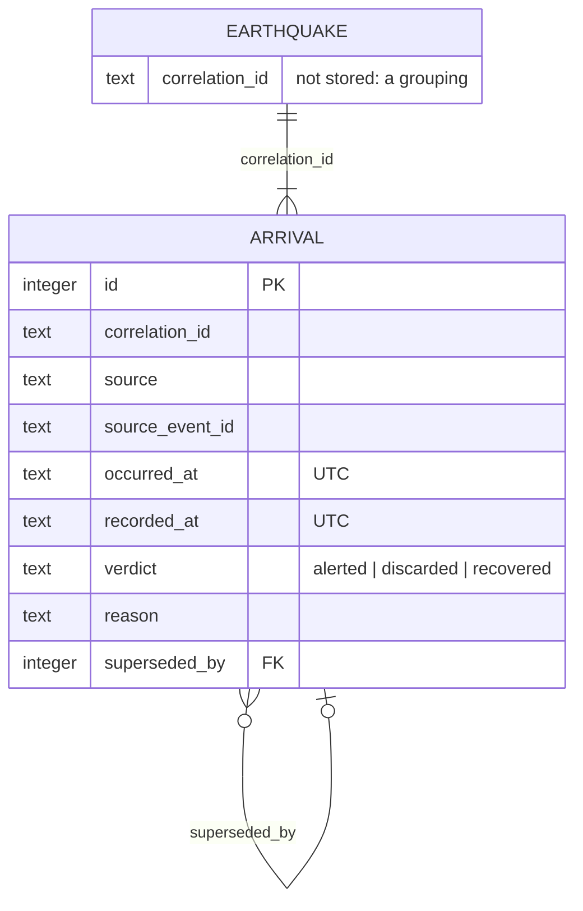

# Data Model delta — Vigía-eew v1.1

> Artifact 05 of the v1.1 kit · 2026-11-16 · Base commit: `bb58be8`
> Base documents: [`docs/DATA-MODEL.md`](../DATA-MODEL.md) and
> [`docs/v1/05-DATA-MODEL-DELTA.md`](../v1/05-DATA-MODEL-DELTA.md)

## 1. Scope

| What | Change |
|---|---|
| Table `events` | **No schema change.** One new value of `verdict`; `SCHEMA_VERSION` stays at 1 |
| Readings of `events` | A second one, per earthquake — a query, not a table |
| Retention | Two figures instead of one |
| Configuration | Six new keys in three sections |
| `state.json` | One new field, `last_drill` |
| Exported files | Two formats, written on demand, owned by the user |
| Domain contract | `SeismicEvent` unchanged; `AlertData` gains the lines about the shaking and the drill |

The features artifact announced the first schema migration. Designing it showed it is not needed
(ADR-037); §2.1 says why, and §2.4 says what that leaves untested.

---

## 2. The history

### 2.1 `events.verdict` — a third value

| Value | Meaning | `reason` | Written by |
|---|---|---|---|
| `alerted` | The agent evaluated it and alerted | — | the processor |
| `discarded` | The agent evaluated it and did not alert | why | the processor |
| **`recovered`** | **The agent was not watching; it was read from a catalogue afterwards** | — | `backfill` |

The column answers *"what did the agent do with this arrival?"*. *"It was not watching"* is a third
answer to that question. A separate `provenance` column would make *alerted and recovered*
representable, which REQ-HIS-011 forbids, and would cost the first migration of the user's own
record to do it.

**Invariants.**

- A row is `recovered` only if no evaluated row exists for the same `(source, source_event_id)`.
- `record_recovered()` inserts with `ON CONFLICT (source, source_event_id) DO NOTHING`: it never
  changes a row that is there.
- `record()` — the live path — replaces the row of the same arrival, as it does today. So
  `recovered` → `alerted`/`discarded` can happen; the reverse cannot.
- `recorded_at` of a recovered row is the instant of the recovery. It says nothing about how long
  the network took, which is why latency excludes those rows (REQ-EST-002).
- `distance_km` of a recovered row is the distance to the reference point at the time of recovery.

**Received live** is the predicate `verdict IN ('alerted', 'discarded')`, defined once beside
`HistoryQuery`.

### 2.2 The per-earthquake reading

Not a table. A query over `events` that keeps one row per `correlation_id` among the arrivals that
match the filter. The row kept is the first by:

| Order | Criterion | Why |
|---|---|---|
| 1 | `verdict = 'alerted'` | What the user was told is what the earthquake was, for them |
| 2 | `superseded_by IS NULL` | The arrival the deduplicator let prevail (ADR-026) |
| 3 | Network rank (REQ-ING-011) | The user's own order of trust |
| 4 | Lowest `id` | Deterministic |

The index it uses, `events_correlation_id`, has existed since the initial schema.



### 2.3 Retention

| Rows | Key | Default | Bound |
|---|---|---|---|
| Evaluated (`alerted`, `discarded`) | `[history] retention_days` | 90 | unchanged |
| Recovered | `[history] recovered_retention_days` | **365** (D-5) | also the furthest back a recovery may ask |

One `DELETE` with both cut-offs, preceded by the existing step that clears `superseded_by` on rows
about to lose their target. Applied when the file is opened, as now.

A recovered row whose earthquake also has an evaluated row outlives it: after 90 days the earthquake
is still in the history, read as *recovered*. That is the intended effect of D-5 — depth — and it is
honest: the agent's own verdict on that earthquake has aged out, and the row says so by what it is.

**Volume.** Measured on 2026-11-16: the local history holds 14 360 rows. For the default recovery
circle — 1 000 km around Caracas, M ≥ 2.5 — the catalogues returned, for October 2026: EMSC 109
events, USGS 91, GEOFON 4. That is about 200 arrivals a month, some 2 500 for a full year of
recovery: a sixth of what the file already holds. One month is a sample, not a rate (Analyze,
V-06).

### 2.4 Schema version

Stays at **1**. The migration mechanism (REQ-HIS-003) is exercised by its tests with synthetic
migrations and has still never taken a real file from one version to the next. This delta does not
change that, and does not claim to.

---

## 3. Configuration

Six keys. All appear in the schema, in `config.toml.example` with a comment, and — because the
panel is generated from the schema (ADR-020) — in the panel with no further work.

| Section | Key | Type | Default | Constraint | Requirement |
|---|---|---|---|---|---|
| `[emsc]` | `catalog_url` | string | `https://www.seismicportal.eu/fdsnws/event/1/query` | https URL | REQ-HIS-010 |
| `[history]` | `recovered_retention_days` | integer | `365` | ≥ 0 | REQ-HIS-013 |
| `[history]` | `recovery_radius_km` | number | `1000` | > 0 | REQ-HIS-010 |
| `[history]` | `recovery_min_magnitude` | number | `2.5` | ≥ 0 | REQ-HIS-010 |
| `[drill]` | `enabled` | boolean | `false` | — | REQ-UX-007 |
| `[drill]` | `interval_days` | integer | `30` | ≥ 1 | REQ-UX-007 |

`[drill]` is a new section, the eleventh.

The recovery radius and magnitude are separate from the alert's on purpose: the alert's keys answer
*"what should wake me?"*, these answer *"what is my region?"*. Their defaults are a proposal and are
flagged for the maintainer in the Analyze (V-05).

What is **not** configurable, and is a named constant instead: the playback's bound and step limits
(they come from a measurement, not a preference), the fading interval, the S-wave velocity.

---

## 4. Operating state — `state.json`

One field is added to `AppState`:

```json
"last_drill": {
  "presented_at": "2026-12-01T14:00:03+00:00",
  "acknowledged_at": "2026-12-01T14:00:41+00:00"
}
```

| Field | Type | Meaning |
|---|---|---|
| `last_drill` | object or absent | Absent until the first drill |
| `presented_at` | instant, UTC | When the drill was put on screen |
| `acknowledged_at` | instant, UTC, or null | Null if it was closed without acknowledgement — replaced by a real alert, or the agent stopped |

**Why here and not in the history.** It is operating state — *when did this machine last prove it
can alert* — not an earthquake. E-05 puts operating state in JSON and earthquakes in SQLite. Kept
out of `events`, a drill needs no filtering by any reading (X-3). Only the last one is kept: the
requirement asks for the last, and a log of drills is what the application log already is.

`AppState.version` stays at 1: the field is optional and an older agent ignores it. It is written
through `StateStore.save()`, atomically, like every other field.

Both `--simulate` and a scheduled drill update it.

---

## 5. Exported files

Written only when the user asks, to a path the user chooses. The agent does not read them back.

### 5.1 CSV

UTF-8, comma-separated, one header row, one row per entry of the reading on screen.

| Column | Content |
|---|---|
| `occurred_at`, `recorded_at` | ISO-8601, UTC, with offset |
| `magnitude`, `depth_km`, `distance_km`, `latitude`, `longitude` | numbers, `.` as decimal separator |
| `region`, `source`, `source_event_id`, `correlation_id` | as stored |
| `verdict`, `reason`, `severity` | as stored |

### 5.2 GeoJSON

A `FeatureCollection` (RFC 7946). Each entry is a `Feature` with a `Point` geometry
`[longitude, latitude]` and the same fields as properties.

Neither file carries anything the history does not: no reference point, no configuration.

---

## 6. Domain entities

| Entity | Change |
|---|---|
| `SeismicEvent` | **None.** The internal contract is untouched |
| `EventRecord` | None in shape; `verdict` admits `recovered` |
| `HistoryQuery` | Gains `reading` (`arrival` \| `earthquake`) and the network rank used to pick the representative |
| `AlertData` | Gains `shaking` (the formatted line, or empty) and `is_drill` |
| `SourceSpec` | Gains `recovery`: how to read the catalogue, or why it cannot be read |
| `AppState` | Gains `last_drill` |

New value objects, all immutable: `Frame` and `Timeline` (playback), `Summary` (figures),
`ShakingEstimate`, `RecoveryOutcome` (per network: recovered, already present, or failed/unsupported
with its reason).

## 7. Data the system still does not store

- The user's position history: `distance_km` is per row, the reference point is not logged.
- Which tiles were requested.
- Drills other than the last.
- Anything about a recovery other than the rows it wrote and a log line.

## 8. Constitution check

| Article | Compliance |
|---|---|
| Art. 2 | The uniqueness key and `DO NOTHING` make recovery repeatable; the live path keeps the last word on a row |
| Art. 4 | Every stored and exported instant is UTC with offset |
| E-05 | Earthquakes in SQLite, operating state in JSON — unchanged, and `last_drill` placed by that rule |
| REQ-HIS-003 | No migration introduced; none needed |
| REQ-HIS-004 | The history stays bounded: two retentions, both finite by default |
| REQ-HIS-006 | The export is written by the user's action to the user's disk; nothing is transmitted |
