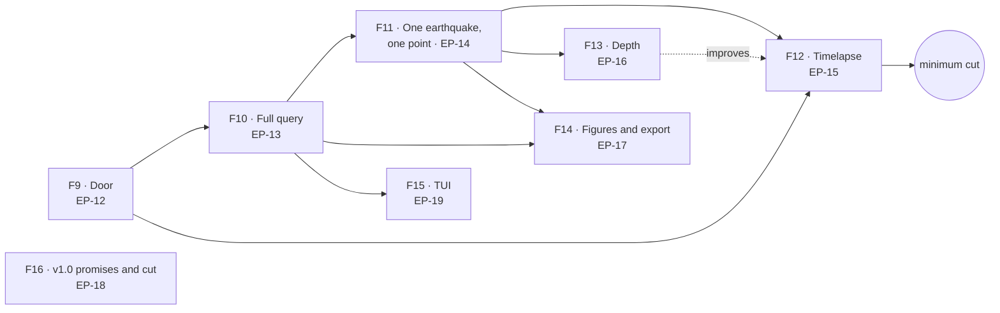

# Implementation Plan — Vigía-eew v1.1

> Artifact 06 of the v1.1 kit · 2026-11-16 · Base commit `bb58be8` · Target **v1.1.0**
> **10 backlog items** in **8 phases**, with 31 tasks in [07-TASKS.md](07-TASKS.md).

## 1. How it relates to the plans that exist

| Plan | Relation |
|---|---|
| [`docs/v1/06-IMPLEMENTATION-PLAN.md`](../v1/06-IMPLEMENTATION-PLAN.md) | Phases F0..F8, closed with v1.0.0. **This plan continues the numbering: F9..F16** |
| [`docs/IMPLEMENTATION-PLAN.md`](../IMPLEMENTATION-PLAN.md) | The repository's living plan. Each phase here updates its structure, its phase table and its requirement → module matrix as it lands (CLAUDE.md, SDD section) |
| [`docs/features/ROADMAP.md`](../features/ROADMAP.md) | F-03, F-10 (second half) and F-13 leave it as built; F-04, F-05, F-08, F-11 stay |
| [`docs/BACKLOG-PRIORIZADO.md`](../BACKLOG-PRIORIZADO.md) | B-44..B-53 are added; B-32 is absorbed by B-49 |

One phase per epic. The epics were cut along the lines of what can ship alone, and a phase that
held two of them would be a phase that cannot be cut in half.

---

## 2. Phase graph

### The blocking chain, and why each link is one

| Link | Why it blocks |
|---|---|
| F9 → F10 | A filter nobody can open is not verifiable by its own criterion — *"can be set from the history screen"* |
| F10 → F11 | The reading switch is a control of the list F10 turns into the owner of the query |
| F11 → F12 | Without one row per earthquake, the playback shows duplicates from its first frame |
| F9 → F12 | The playback pauses on the notice F9 gives a covered screen (X-4) |
| F11 → F13 | A recovered arrival joins an existing earthquake; *"shown once"* needs the per-earthquake reading to be checked |
| F10, F11 → F14 | The figures count the filtered set, and half of them count earthquakes (X-8) |
| F10 → F15 | The terminal reuses the filter state F10 moves into the list (X-7) |

**F16 depends on nothing.** It is last because D-7 put it there, not because anything feeds it.

**F13 does not block F12.** The playback plays whatever the history holds. Recovery makes it worth
watching on a fresh install; it does not make it work.

---

## 3. The phases

Each phase ends with the gate green — `pytest`, `ruff check .`, `mypy src`, `lat check` — and one
commit, by the project's convention.

### F9 · The history gets a door

| | |
|---|---|
| **Epic / story** | EP-12 · HU-113 |
| **Tasks** | T-152..T-155 |
| **Delivers** | `--history`; a launcher action; navigation between the three screens; a screen told when an alert covers it |
| **Touches** | `cli.py`, `app.py`, `wiring.py`, `notify/flet_shell.py`, `notify/navigation.py` *(new)*, `packaging/` |
| **Schema / config** | none |
| **Risk** | Low. It copies T-150. The one thing to get wrong is the alert's precedence, and CA-113.6 is the test |
| **Exit** | `vigia-eew --history` opens the history on a GNOME/Wayland session; from `--settings` the history is reached and returned from |

### F10 · The interface queries everything the store knows

| | |
|---|---|
| **Epic / story** | EP-13 · HU-114 |
| **Tasks** | T-156..T-160 |
| **Delivers** | The three missing filters; paging; the map reading the whole filtered set; symbols as markers with a tooltip; table ↔ map selection |
| **Touches** | `history.py`, `notify/history_view.py`, `notify/history_map.py`, `notify/history_window.py`, `timeutil.py`, `i18n.py` |
| **Schema / config** | none |
| **Risk** | Medium. Markers cost more than circles (ADR-033); until T-163 measures it, `MAP_SYMBOL_LIMIT` is a provisional figure |
| **Exit** | An earthquake from three weeks ago, from one network, is found from the screen; choosing it in the table shows which symbol it is |

### F11 · One earthquake, one point

| | |
|---|---|
| **Epic / story** | EP-14 · HU-115 |
| **Tasks** | T-161, T-162 |
| **Delivers** | The per-earthquake reading, its count, the arrivals of an earthquake, and the switch on the screen |
| **Touches** | `history.py`, `notify/history_view.py`, `notify/history_window.py` |
| **Schema / config** | none — the index exists |
| **Risk** | Low–medium. One window-function statement per ordering, which needs SQLite ≥ 3.25; T-161 asserts it |
| **Exit** | An earthquake reported by EMSC and USGS is one line and one symbol, and both arrivals can be read from it |

### F12 · The history in motion

| | |
|---|---|
| **Epic / story** | EP-15 · HU-116 |
| **Tasks** | T-163..T-166 |
| **Delivers** | The spike and its verdict; the pure timeline; the playback control; its integration as a third reading |
| **Touches** | `notify/timelapse.py` *(new)*, `notify/timelapse_view.py` *(new)*, `notify/history_window.py`, `notify/history_map.py`, `10-SPIKE-TIMELAPSE.md` *(new)* |
| **Schema / config** | none |
| **Risk** | **The highest of the plan.** P-2 is open: nobody has measured one redraw. T-163 is first and can change T-165 and T-166 |
| **Exit** | Thirty days play from start to end in under a minute with the date in view, and a simulated alert during playback interrupts it |

**Stop rule.** If T-163's verdict is that `flet-map` cannot redraw the bound the closing criterion
needs, T-165 and T-166 are not started; the epic goes back to design with the measurement in hand.

### F13 · A history with depth

| | |
|---|---|
| **Epic / story** | EP-16 · HU-117 |
| **Tasks** | T-167..T-171 |
| **Delivers** | Four configuration keys; the two-retention prune; the catalogue readers; `backfill.py`; `--backfill` and the *Recover…* action; the third style |
| **Touches** | `config.py`, `config.toml.example`, `history.py`, `ingest/catalogue.py` *(new)*, `ingest/registry.py`, `pipeline/dedup.py`, `backfill.py` *(new)*, `cli.py`, `notify/history_*.py`, `pyproject.toml` (import contract), `docs/API-SPEC.md` |
| **Schema / config** | **No schema change** (ADR-037). Four keys |
| **Risk** | Medium. Three live services; joining recovered arrivals to existing earthquakes reuses a heuristic written for a 90-second window in a stream |
| **Exit** | An empty history is completed with 90 days; no row can be mistaken for a discard; repeating duplicates nothing; the rows survive a restart |

### F14 · Figures and data out

| | |
|---|---|
| **Epic / story** | EP-17 · HU-118 |
| **Tasks** | T-172..T-175 |
| **Delivers** | `history_stats.py`, its view, `history_export.py`, the export action |
| **Touches** | `history_stats.py` *(new)*, `history_export.py` *(new)*, `notify/history_stats_view.py` *(new)*, `notify/history_window.py` |
| **Schema / config** | none |
| **Risk** | Low, with one unknown: the system file dialog in the packaged binary (P-5) — hence the fallback |
| **Exit** | The screen says how many earthquakes were evaluated in the period and each network's median latency; the same set opens in a spreadsheet |

### F15 · The history over SSH

| | |
|---|---|
| **Epic / story** | EP-19 · HU-121 |
| **Tasks** | T-176 |
| **Delivers** | A history screen in the terminal dashboard |
| **Touches** | `tui.py`, `wiring.py` |
| **Risk** | Low |
| **Exit** | `vigia-eew --tui` offers the filterable list over an SSH connection |

**`[SHOULD]`. The first phase to be cut.**

### F16 · What v1.0 promised, and the cut

| | |
|---|---|
| **Epic / stories** | EP-18 · HU-119, HU-120 |
| **Tasks** | T-177..T-182 |
| **Delivers** | The estimate of the shaking in the alert; the drill label; the scheduled drill; the queue's rule between a drill and a real alert; the v1.1.0 cut |
| **Touches** | `shaking.py` *(new)*, `drill.py` *(new)*, `notify/presentation.py`, `notify/alert_window.py`, `notify/queue.py`, `tui.py`, `supervisor.py`, `state.py`, `models.py`, `config.py`, `i18n.py`, `notify/about.py` |
| **Schema / config** | `state.json` gains `last_drill`; two keys in a new `[drill]` section |
| **Risk** | Medium, and of a different kind: T-181 changes `AlertQueue`, the component Art. 1 rests on |
| **Exit** | The simulated alert shows the estimate or how long ago the shaking should have arrived; a scheduled drill fires, is acknowledged and leaves a record |

**Cuttable by D-7.** T-182 — the cut of the release — is not: if EP-18 is dropped, T-182 moves to
the end of whatever phase is last.

---

## 4. Requirement coverage by phase

| Phase | Requirements | MUST | SHOULD |
|---|---|---|---|
| F9 | REQ-GUI-011..013 | 3 | — |
| F10 | REQ-HIS-005 *(strengthened)*, REQ-HIS-007, 008 · REQ-MAP-006, 007 | 5 | — |
| F11 | REQ-HIS-009 | 1 | — |
| F12 | REQ-TLP-001..008 | 8 | — |
| F13 | REQ-HIS-010..013 | 4 | — |
| F14 | REQ-EST-001..003 · REQ-HIS-014 | 4 | — |
| F15 | REQ-HIS-015 | — | 1 |
| F16 | REQ-ALE-011..013 · REQ-UX-007..009 | 6 | — |
| **Total** | **32** | **31** | **1** |

No requirement is in two phases; none is in none.

## 5. Cut condition for v1.1.0

| | |
|---|---|
| **Minimum cut** | F9 + F10 + F11 + F12 — the request: a history that can be opened, and its timelapse |
| **Order of cutting** | F15 (EP-19), then F16's EP-18 tasks, then F14 (EP-17), then F13 (EP-16) |
| **Gate** | `pytest`, `ruff check .`, `mypy src`, `lat check`, the import contracts, and the GUI smokes with `VIGIA_GUI_TESTS=1` on a display |
| **Evidence** | Each phase's exit criterion observed on the packaged binary, not only on the source tree — the lesson of T-150 |
| **Spec** | Every `CA` of the phases that ship is covered by a test or by an observation recorded in the task |
| **Version** | `1.1.0` in `pyproject.toml`, tag `v1.1.0`; `build.yml` publishes |

A cut phase leaves nothing half-built: each rule in *Where the epics touch* (01 §3) is followed by
the earlier phase, so the later one can be absent.

## 6. What this plan does not do

- **It does not move Wayland** (B-20). The playback and the navigation run inside the window the
  alert already uses; whatever that window can and cannot do under Wayland is unchanged.
- **It does not schedule background recovery**, SeedLink, the intensity filter, tsunami warnings or
  multiple reference points.
- **It does not fix the drift in `docs/v1/HU/HU-112`**, which still describes the map on Tk and
  Pillow. T-182 notes it in the v1.0 kit; it does not rewrite it.
- **It does not set dates.** [09-ESTIMATE](09-ESTIMATE.md) gives hours of effort with a range.

## 7. Constitution check

| Article | In this plan |
|---|---|
| Art. 1 | F9 and F16 each carry a criterion that puts a real alert against the new thing — CA-113.6, CA-116.10, CA-120.7, CA-120.8 — and the phase does not exit without it |
| Art. 7 | Every phase's tests run headless; the GUI smokes are opt-in and part of the cut, not of each commit |
| Art. 9 | Each task names the specification and the `lat.md` section it updates. `lat check` is in every phase's gate |
